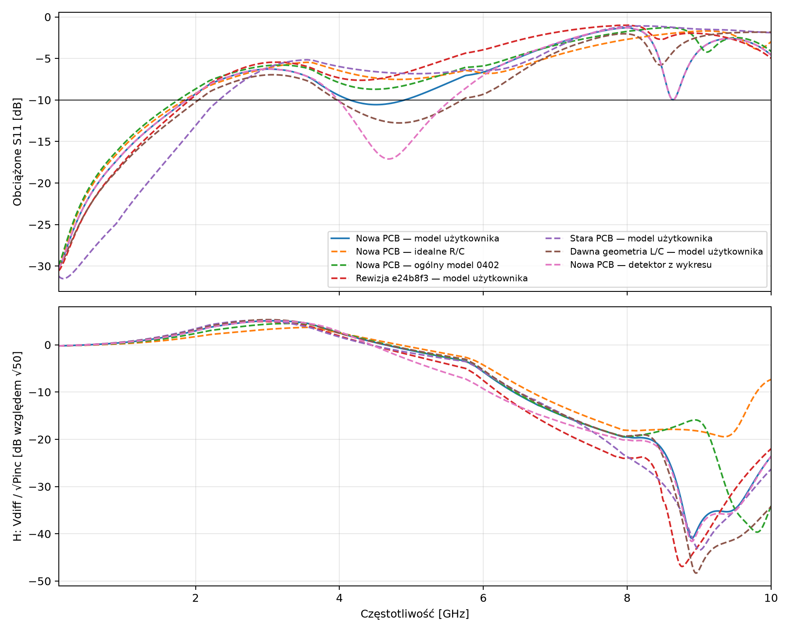

# AD8317 — wyniki rewizji wip_40b50f97 (PCB niezacommitowana)

Źródło: gałąź feature/wurth-60312202114307-short-sma, HEAD e24b8f32 + NIEZACOMMITOWANE zmiany PCB/DRU/PRO (PCB SHA-256 40B50F97). DRC (kicad-cli, refill): 226 naruszeń, 0 błędów, 0 niepołączonych. Zszycie: 30/30 PTH GND J1 ma kontakt z wypełnionymi płaszczyznami GND. Pad 9 U1 ma teraz sieć GND (4 vias GND + strefa F.Cu); vias w antipadzie In1 usunięte.

Ścieżka RF (obowiązkowy opis): linia współpłaszczyznowa z masą (CPWG) na F.Cu nad płaszczyzną GND In1; prepreg 0,10 mm FR4 εr=4,4, tanδ=0,02; Cu 35 µm. Szerokości i odstępy z KiCad, Z0 quasi-statycznie (conformal mapping, korekta grubości 35 µm, bez ENIG): Net-(J1-In): ścieżka w=0.1524 mm, L=0.34 mm, odstęp GND Top 0.574–0.614 mm, Z0≈55–55 Ω; Net-(J1-In): ścieżka w=0.1524 mm, L=0.22 mm, odstęp GND Top 0.318–0.384 mm, Z0≈53–54 Ω; Net-(J1-In): ścieżka w=0.1500 mm, L=0.99 mm, odstęp GND Top 0.252–0.354 mm, Z0≈53–54 Ω; Net-(J1-In): ścieżka w=0.2032 mm, L=0.07 mm, odstęp GND Top 0.448–0.484 mm, Z0≈46–47 Ω; Net-(J1-In): ścieżka w=0.1524 mm, L=0.78 mm, odstęp GND Top 0.160–0.706 mm, Z0≈51–55 Ω; Net-(U1-INHI): ścieżka w=0.2500 mm, L=1.53 mm, odstęp GND Top 0.526–0.566 mm, Z0≈41–42 Ω; Net-(U1-INHI): ścieżka w=0.2500 mm, L=0.26 mm, odstęp GND Top 0.656–0.786 mm, Z0≈42–42 Ω; Net-(U1-INLO): ścieżka w=0.2500 mm, L=1.70 mm, odstęp GND Top 0.396–0.406 mm, Z0≈41–41 Ω; Net-(J1-In): grafika Cu w=0.1500 mm, L=1.07 mm, odstęp GND Top 0.300–0.364 mm, Z0≈54–54 Ω. Przejście SMA→linia to custom pad J1-1 (x 140,40–143,95 mm, footprint 307_b0).

Pokrycie i maska: sygnał i masa wokół linii są odkryte (okno F.Mask 134,38–150,09 × 82,74–87,22 mm oraz okna boczne J1) – w tej rewizji modelu maskę WYCIĘTO zgodnie z rzeczywistymi kształtami F.Mask z KiCad (sondy: nad linią RF i INHI brak maski, poza oknem maska jest). Wykończenie ENIG (Ni ~3–6 µm, Au ~0,05–0,1 µm) NIE jest modelowane: miedź σ=5,8e7 S/m. Ni zwiększa straty przy GHz (efekt naskórkowy w Ni), dla ~5 mm linii szacunkowo <0,1–0,2 dB przy 10 GHz; wpływ na S11 jest pomijalny, na tłumienie – niewielki.

Symulacja: HFSS 2026 R1, 7 portów (P1 = port falowy na licu SMA z PEC cap, porty skupione na INHI/INLO/R1/R2/C1/C2), adaptacja 1/5/10 GHz, ΔS = 0,02; sweep 1 MHz–10 GHz, 1001 próbek. Ostatni przebieg adaptacyjny: 6; ostatnie dwa ΔS: 0.007842 / 0.003319. Ocena dotyczy 0,1–10 GHz.

Wynik całego obciążonego toru (model użytkownika): najgorsze S11 -1.30 dB przy 8.000 GHz; S11 < −10 dB dla 25.6% próbek; średnie S11 -8.13 dB. Rewizja e24b8f3: -0.99 dB przy 8.020 GHz, 18.4%, średnio -6.92 dB. Stara PCB: -1.09 dB, 22.5%, średnio -8.26 dB. Rozrzut H: nowa 46.05 dB, e24b8f3 51.84 dB.

W zakresie 0,1–1 GHz: najgorsze S11 -16.44 dB, rozrzut H 0.71 dB. Minimum H -40.95 dB przy 8.900 GHz. S11 dotyczy całego miernika (SMA + linia + R1/R2 + C1/C2 + wejście AD8317), nie samego przejścia SMA.

Pasywność: największa wartość singularna macierzy S 1.000393; danych nie poprawiano. Bilans mocy obciążonej sieci sprawdzono. Wynik porównawczy, nie certyfikacja dokładności.

Model użytkownika: C1=C2=47 nF 0402, ESL=0,7 nH, ESR=0,04 Ω; R1=R2=100 Ω. Modele pasożytów R i ogólny model 0402 są założeniami, nie modelami producenta. Wnętrze SMA (PTFE εr 2,1), stop lutowniczy (7e6 S/m) i lite przelotki (ścianka 25 µm) to przybliżenia inżynierskie.

Różnice względem e24b8f3 w modelu: (1) pad 9 natywnie GND zamiast odtworzonego no-net, (2) usunięte vias z antipadu In1, (3) pełne zszycie 30 PTH GND, (4) maska zdjęta z okna RF (w e24b8f3 maska pokrywała linię; wpływu samej maski nie wydzielono osobną symulacją – różnica wyników obejmuje wszystkie cztery zmiany łącznie).

Wnioski: względem e24b8f3 poprawiło się średnie S11 (-6.92 → -8.13 dB) i udział pasma z S11 < −10 dB (18.4 → 25.6%). Najgorsze S11 całego miernika nadal ok. −1,3 dB przy ~8 GHz; nawet z idealnymi R/C wynosi -1.69 dB, a izolowane przejście 307_b0 dawało −25,55 dB. Ograniczeniem powyżej ~3 GHz jest więc sieć zakończenia (R1/R2, C1/C2, pady i odcinki linii do AD8317 oraz impedancja wejścia detektora), nie samo złącze SMA. Ewentualną optymalizację L/C należy kierować na tę sieć, nie na przejście SMA.

## Wyniki całego obciążonego toru: 0,1–10 GHz

| Wariant | Najgorsze S11 | f tego S11 | Udział próbek S11 < −10 dB | Rozrzut H |
|---|---:|---:|---:|---:|
| Nowa PCB — model użytkownika | -1.30 dB | 8.000 GHz | 25.6% | 46.05 dB |
| Nowa PCB — idealne R/C | -1.69 dB | 9.110 GHz | 17.7% | 23.14 dB |
| Nowa PCB — ogólny model 0402 | -1.30 dB | 8.570 GHz | 16.8% | 44.16 dB |
| Rewizja e24b8f3 — model użytkownika | -0.99 dB | 8.020 GHz | 18.4% | 51.84 dB |
| Stara PCB — model użytkownika | -1.09 dB | 8.220 GHz | 22.5% | 48.60 dB |
| Dawna geometria L/C — model użytkownika | -1.83 dB | 9.880 GHz | 37.1% | 53.64 dB |
| Nowa PCB — detektor z wykresu | -1.28 dB | 8.000 GHz | 33.7% | 46.71 dB |

H jest napięciem różnicowym względem fali padającej, nie S21 ani mocą detektora.

## Nowa PCB, model użytkownika: wyniki pasmowe

| Pasmo | Najgorsze S11 | Rozrzut H |
|---|---:|---:|
| 0.1-1GHz | -16.44 dB | 0.71 dB |
| 1-3GHz | -6.28 dB | 4.59 dB |
| 3-6GHz | -6.27 dB | 10.74 dB |
| 6-8GHz | -1.30 dB | 13.76 dB |
| 8-10GHz | -1.30 dB | 21.44 dB |

Dane pasmowe, kontrola pasywności i hashe: [metrics.json](metrics.json).
Krzywe w plikach CSV można ponownie analizować bez uruchamiania HFSS.
Snapshot Git: [source_project](../source_project/). Diagnostyczne PCB z refill/solid nie są zatwierdzonymi poprawkami źródła.